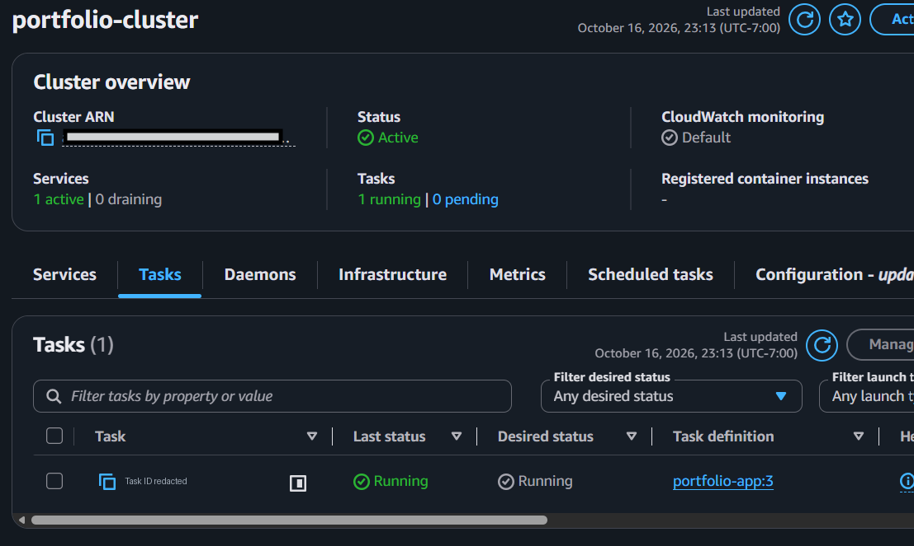

# cloud-devops-portfolio

A Flask application that served my portfolio site from a Docker container on AWS ECS Fargate, behind an Application Load Balancer.

## Status

The AWS deployment is stopped. On October 18, 2026 I set the ECS service to 0 tasks and deleted the load balancer to reduce costs.

The portfolio is now hosted on Cloudflare Pages at <https://zaryaamin.pages.dev>. The React source for that site is in [ZaryaA101/pixel-perfect](https://github.com/ZaryaA101/pixel-perfect). This repository holds the Flask and Docker setup and the AWS deployment configuration.



*ECS console while the service was running, October 2026.*

## The application

`app.py` has no database, API or environment variables. It serves the frontend build and a few static files:

| Path | Response |
| --- | --- |
| `/` | `templates/index.html` |
| `/Zarya_Amin_Resume.pdf` | resume PDF, sent as a download |
| `/images/Zarya_Amin_Graduation.webp` | graduation photo |
| other files in `static/` | served from the site root |

`templates/` and `static/` contain the frontend build that was deployed to ECS.

## Docker

The `Dockerfile` starts from `python:3.12-slim`, installs `requirements.txt`, copies `app.py`, `templates/` and `static/`, and runs Gunicorn on port 5000. The container runs as root and has no health check. `.dockerignore` keeps the virtual environment, Git data, local env files and the deployment JSON files out of the image.

## AWS deployment (us-west-2)

- **ECR:** the image was pushed to the `portfolio-app` repository. The first image used the `latest` tag; later images were tagged with a date and commit ID. Revision 4 used the tag for commit `23182d1`.
- **ECS Fargate:** service `portfolio-service` in cluster `portfolio-cluster` ran one task in the default VPC with a public IP. The task definition `portfolio-app` (revisions 1–4, which differ only in the image tag) used 0.25 vCPU, 512 MiB and container port 5000.
- **Load balancer:** `portfolio-alb` was internet-facing, with one HTTP listener on port 80 forwarding to target group `portfolio-tg`. The target group sent requests to task IPs on port 5000 and health-checked `GET /`. There was no HTTPS listener or custom domain.
- **IAM:** the task used the existing `ecsTaskExecutionRole` with the AWS-managed `AmazonECSTaskExecutionRolePolicy`, which allows ECS to pull the image from ECR and write logs. There is no task role because the app does not call AWS. `ecs-task-trust-policy.json` is that role's trust policy.
- **Security groups:** `portfolio-alb-sg` allowed inbound TCP 80 from anywhere. `portfolio-sg`, on the task, allowed inbound TCP 5000 only from `portfolio-alb-sg`.
- **CloudWatch:** the `awslogs` driver sent container output to the log group `/ecs/portfolio-app`.

### Changes on October 18, 2026

Changed: the ECS service desired count (1 to 0) and the load balancer `portfolio-alb`, which was deleted along with its listener.

Kept: the cluster, the service, task definitions 1–4, the ECR repository and images, the log group, the IAM role, the target group, the security groups and the default VPC.

## Run locally

```sh
docker build -t portfolio-app .
docker run --rm -p 5000:5000 portfolio-app
```

Open <http://localhost:5000>. Without Docker, using Python 3.12:

```sh
python3 -m venv venv
. venv/bin/activate
pip install -r requirements.txt
python app.py
```

`python app.py` runs Flask's development server. The container uses Gunicorn.

## Redeploying to ECS

I have not tested this procedure since the shutdown. The cluster, service and task definitions still exist, but the load balancer has to be recreated before the service is reachable from the internet. Its new DNS name will differ from the old one.

`task-definition.json` is a reference template, not an export of a registered revision. Replace `<ACCOUNT_ID>` and `<GIT_COMMIT_SHA>` before using it.

1. Build and push an image tagged with the commit ID. This needs the AWS CLI, Docker and permission to push to ECR.

   ```sh
   export AWS_REGION=us-west-2
   ACCOUNT_ID=<ACCOUNT_ID>   # your 12-digit AWS account ID
   TAG=$(git rev-parse HEAD)
   REGISTRY=$ACCOUNT_ID.dkr.ecr.$AWS_REGION.amazonaws.com

   docker build -t portfolio-app:$TAG .
   aws ecr get-login-password | docker login --username AWS --password-stdin $REGISTRY
   docker tag portfolio-app:$TAG $REGISTRY/portfolio-app:$TAG
   docker push $REGISTRY/portfolio-app:$TAG
   ```

2. Put the account ID and tag into `task-definition.json`, then register it:

   ```sh
   aws ecs register-task-definition --cli-input-json file://task-definition.json
   ```

3. Recreate the load balancer in two subnets of the default VPC, using `portfolio-alb-sg` and the existing `portfolio-tg`:

   ```sh
   aws ec2 describe-subnets --filters Name=default-for-az,Values=true \
     --query 'Subnets[].[SubnetId,AvailabilityZone]' --output text

   ALB_ARN=$(aws elbv2 create-load-balancer --name portfolio-alb \
     --scheme internet-facing --type application \
     --subnets <SUBNET_A> <SUBNET_B> \
     --security-groups <PORTFOLIO_ALB_SG_ID> \
     --query 'LoadBalancers[0].LoadBalancerArn' --output text)
   TG_ARN=$(aws elbv2 describe-target-groups --names portfolio-tg \
     --query 'TargetGroups[0].TargetGroupArn' --output text)
   aws elbv2 create-listener --load-balancer-arn "$ALB_ARN" --protocol HTTP --port 80 \
     --default-actions Type=forward,TargetGroupArn="$TG_ARN"
   ```

4. Start the service on the new revision:

   ```sh
   aws ecs update-service --cluster portfolio-cluster --service portfolio-service \
     --task-definition portfolio-app --desired-count 1
   ```

Running tasks and the load balancer are billed while they exist.

## Files

| File | Purpose |
| --- | --- |
| `app.py` | Flask application |
| `Dockerfile`, `.dockerignore` | image build |
| `requirements.txt` | pinned Python dependencies |
| `task-definition.json` | ECS task definition reference template |
| `ecs-task-trust-policy.json` | trust policy for the task execution role |
| `templates/`, `static/` | frontend build, resume and images |
